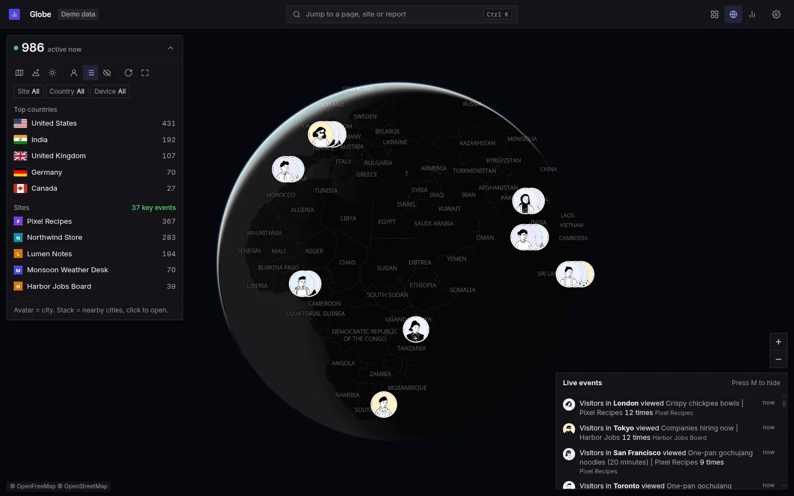

# GA4 Dashboard

Real-time Google Analytics 4 (GA4) dashboard with a live globe, traffic spike detection, visitor insights, and a Model Context Protocol (MCP) server for AI assistants.


**Watch the 48 second demo on YouTube:** https://youtu.be/bZbx4_8PIXE

<details>
<summary>More screenshots</summary>

<table>
<tr>
<td width="33%"></td>
<td width="33%"></td>
<td width="33%"></td>
</tr>
<tr><td>Home</td><td>Analytics</td><td>Globe, dark theme</td></tr>
</table>

Screenshots use demo mode (generated data, fictional sites).

</details>

---

## Features

- **Real-time Analytics Dashboard**: Live active user monitoring, property comparison, traffic recipes, and quota tracking.
- **Live Globe**: Shows live visitors as avatars on a MapLibre globe (or a flat map), with city cards, day and night shade, and a live event feed.
- **Spike Detection**: Automatically detects sudden traffic surges and classifies traffic sources (referral, direct, campaign).
- **Visitor Insights**: Aggregates persona cards for new vs. returning visitors, device breakdowns, and top geography.
- **Retention**: `/retention` shows native GA4 daily and weekly first-visit cohorts, weighted retention curves, previous-period comparisons, a heatmap with user counts, cell details and CSV export. Uses the property's time zone and Sunday-based GA4 weeks; incomplete return periods are excluded from averages. Reports are cached for one hour.
- **Embeds**: Native Rybbit visitor badges (card or inline pill) and dashboard iframes, with interactive previews, copyable HTML, theme controls and revocable private dashboard links.
- **MCP Server**: Query GA4 properties, funnels, and reports from HTTP-capable AI tools through Streamable HTTP at `/mcp`, using the latest stable MCP TypeScript SDK v2. It shares the dashboard's `.env`, caches and quota protection.
- **Privacy Shield**: Redacts full URL parameters and query strings to prevent private data leakage on dashboards.
- **Smart Caching & Quota Protection**: Disk + in-memory caching layers with automatic background property metadata updates to preserve GA4 API quota.
- **Homepage views**: `/` combines the original site cards with Status, Table and Heatmap views. All four share the date selector, comparison periods, search and optional account grouping. Home also offers Sync properties; names and account metadata refresh automatically every five minutes. The report views retain low-traffic filtering, sorting, CSV export and optional AdSense earnings. Existing `/sites` links redirect to the matching homepage view.
- **Setup page**: Until credentials work, every page opens `/setup`: a prompt for your AI agent and a live checklist that moves on as each step passes.

---

## Prerequisites

- **Node.js**: v22 or higher
- **Package Manager**: [`pnpm`](https://pnpm.io/) (one install at the root covers the dashboard and the MCP server)
- **Google Cloud Platform (GCP) Account**: access to create a Service Account with Google Analytics API permissions

---

## Setup

Full steps, the agent prompt and the manual path: [SETUP.md](SETUP.md).

### Quick start

```bash
git clone https://github.com/TheTechBasket/GA4-Dashboard-MCP.git
cd GA4-Dashboard-MCP
pnpm install
cp .env.example .env
pnpm start
```

Open [http://localhost:5483](http://localhost:5483). It opens `/setup`: copy the prompt into your AI agent (Claude Code, Codex, Gemini CLI). The agent creates a Google Cloud service account and fills `GA4_CLIENT_EMAIL` and `GA4_PRIVATE_KEY` in `.env`. The checklist updates every 3 seconds, no restart needed. The last step is yours: add the service account email as **Viewer** in GA4 Admin, Account access management.

Check from the terminal at any time:

```bash
pnpm setup:check
```

### Demo

No Google account needed:

```bash
pnpm demo
```

Generated data for 8 fictional sites. A "Demo data" badge shows in the bar.

### Run with Docker

Fill `.env` first (see Quick start), then:

```bash
docker run -d --name ga4-dashboard --env-file .env -p 127.0.0.1:5483:5483 ghcr.io/thetechbasket/ga4-dashboard:latest
```

Or with the compose file in this repo:

```bash
docker compose up -d
```

The image has no credentials in it. It reads them from env. Add `-e DEMO=1` instead of `--env-file .env` to try demo mode. The same container serves MCP at `http://localhost:5483/mcp`.

### Report time windows

Home, Analytics, Pages, Events and Journeys use Rybbit's native time presets, including **Last 24 Hours** (shortcut **H**), **Last 30 Minutes**, and typed windows such as `6h`. Rolling windows query GA4 using property-local `dateHourMinute` filters at whole-minute precision. Summary users/sessions come from GA4's filtered aggregate, and comparisons use a separate equal-duration window. Hourly charts align property time to UTC. These historical reports still have GA4 processing delay; `/realtime` supplies live traffic. Retention, native GA4 funnels and Search Console require calendar days; they never silently widen a rolling window. Saved daily AdSense earnings remain unknown for partial-day ranges. MCP's corresponding report tools accept `pastMinutes: 1440` for the same 24-hour window.

### Realtime overview

`/realtime` shows one unified property list for the latest 30-minute GA4 window, independently of historical report dates. Account grouping is available on Home. The feed refreshes every two minutes while auto refresh is enabled. Spike alerts retain the original z-score and lift rules, sensitivity presets, custom thresholds, baseline markers and collapsible banners. Rules rescore the loaded feed locally; source/page context is requested only for the two displayed alerts. Source context is today's historical traffic, not a realtime attribution claim.

Properties can be searched, sorted by unusualness, active users or name. Inactive properties and failed requests remain visible as compact links. The settings menu contains privacy, auto refresh, property-list refresh and API quota. Preferences stay in browser storage. Charts reuse Rybbit's `SiteSessionChart` with an active-users label and a fixed minute bucket; unavailable minute reports are shown as unavailable instead of zero traffic.

Privacy mode applies across the dashboard. Use the eye button at the bottom of the left rail or press **P** outside text fields and dialogs. Realtime and Globe controls share the same preference, including across tabs and reloads. Property/account names and IDs, domains, favicons, page addresses and connection email are visually blurred; statistics remain readable. The preference reuses `pb_privacy` from Realtime. It affects presentation only, so API data and exports retain their original values.

### Widgets

Open **Widgets** from a Home site card, the property's sidebar or the command palette. Widgets has its own page at `/widgets?prop=PROPERTY_ID`, with a property selector, searchable definitions, creation/editing, duplication, enable/disable controls and copyable iframe code. It replaces the former widget settings tabs with one custom component manager. The **Public embeds** switch controls publishing for the selected property; drafts can be configured and previewed before publishing.

**Create widget** opens the same configuration-and-preview editor used by Funnels. Create a component with one to six of 13 GA4 metrics, including active users, pageviews, bounce rate, engagement, events and revenue. Configure labels, number formats, decimal places, date ranges, comparisons, exact page/country/device filters, chart intervals, colors, themes, transparency, columns and width. Cards with trend charts, metrics-only components and inline badges are layouts of the same custom widget. The default is this month's active users, pageviews and bounce rate.

Natural months follow the property's timezone. This month compares the same elapsed dates in the previous month; last month compares the two complete calendar months. Rolling 7/30/90-day ranges, year-to-date, the last 12 months and custom ranges up to 366 days are available. GA4 supplies distinct users and rates for the whole period, and monthly trends query monthly buckets directly. Historical reports are cached for five minutes across previews and iframes.

Widgets can be edited, duplicated, disabled or deleted. Editing keeps the same `/widget/PROPERTY_ID/WIDGET_ID` URL and updates existing embeds on their next refresh. Inline badges fit their contents, treating the configured width as a maximum, and wrap on narrow screens. The copyable HTML automatically adjusts iframe width and height and validates the sending iframe and origin. Definitions are stored with the site's other embed settings; disabling either the site-wide widget switch or an individual component blocks subsequent widget requests.

Embed settings and private keys live in `.data/embeds/PROPERTY_ID.json` (override with `GA4_EMBEDS_DIR`). Back up this directory alongside saved funnels; retain the `/app/.data` Docker volume. These are local dashboard settings and do not change GA4 or require new Google scopes.

Existing visitor-badge and private-dashboard iframe URLs remain supported. Legacy visitor badges retain their realtime/historical windows and minute refresh interval. Private dashboards remain read-only, property-scoped and revocable; the former visitor-badge and dashboard-embed configurator tabs are no longer shown in the UI.

### Saved funnels

`/funnels?prop=PROPERTY_ID` saves named event/page sequences in the dashboard and queries ordered active users directly from GA4 `runFunnelReport`. The page supports creating, editing, cloning and deleting definitions; event steps support exact string/number parameter conditions. Definitions are scoped to each connected property, independent of the selected report dates and filters.

Rules live in `.data/funnels/PROPERTY_ID.json` (override the directory with `GA4_FUNNELS_DIR`). Back up this directory as application data; clearing report caches must not remove it. In Docker, retain the `/app/.data` volume. Saving definitions makes no changes to GA4 and needs no additional Google OAuth scopes. Funnel statistics are not written to these files or the report cache.

New properties start without preset funnels. Saved definitions are preserved across restarts and report cache cleanup.

### MCP server

The dashboard serves Streamable HTTP MCP at `http://localhost:5483/mcp`. Start the dashboard, then register the URL with Claude Code from the project you want it in:

```bash
claude mcp add ga4 --transport http --scope project http://localhost:5483/mcp
```

Use `--scope user` to have it in every project. Replace an existing stdio entry in the same scope before adding this URL. The `/setup#ai` page has the connection prompt. For a separate MCP-only HTTP process, run `pnpm mcp` and use `http://127.0.0.1:5484/mcp` (`MCP_HOST`/`MCP_PORT` are configurable).

MCP includes the original low-level tools and focused tools for native dashboard reports, pages, events, journeys, retention, site health, saved funnels and metric widgets. It shares page calculations, caches, authentication and quota protection. Start with `get_capabilities` and `list_properties`; results include structured content, freshness, quota and truncation details. Tools can save local definitions when requested; previews do not enable sharing or generate keys. Tool details and HTTP client configuration: [mcp-server/README.md](mcp-server/README.md).

### Hosting publicly

The app has no login. Anyone who can reach it sees your GA4 data. Run it on localhost, or put it behind Cloudflare Access or Tailscale before you expose it. With Docker, publish port 5483 on localhost only (`-p 127.0.0.1:5483:5483`) and let the proxy or tunnel reach it there. See Private access below.

### Private access

Both setups reach the app on `127.0.0.1:5483` and open no public port on your server.

**Cloudflare Tunnel plus Access.** Needs a domain on Cloudflare.

```bash
cloudflared tunnel login
cloudflared tunnel create ga4-dashboard
cloudflared tunnel route dns ga4-dashboard ga4.example.com
```

`~/.cloudflared/config.yml` (use the tunnel UUID that `create` printed):

```yaml
tunnel: <Tunnel-UUID>
credentials-file: /home/<user>/.cloudflared/<Tunnel-UUID>.json
ingress:
  - hostname: ga4.example.com
    service: http://127.0.0.1:5483
  - service: http_status:404
```

Test with `cloudflared tunnel run ga4-dashboard`, then run it as a service:

```bash
sudo cloudflared --config /home/<user>/.cloudflared/config.yml service install
sudo systemctl start cloudflared
```

Then add a login in front. In Zero Trust, add the One-time PIN identity provider (Integrations, Identity providers). Then add a self-hosted application for `ga4.example.com` (Access controls, Applications) with an Allow policy for your email addresses. Visitors get a code by email before they see the dashboard.

Docs: [create a tunnel](https://developers.cloudflare.com/cloudflare-one/networks/connectors/cloudflare-tunnel/do-more-with-tunnels/local-management/create-local-tunnel/), [config file](https://developers.cloudflare.com/cloudflare-one/networks/connectors/cloudflare-tunnel/do-more-with-tunnels/local-management/configuration-file/), [run as a Linux service](https://developers.cloudflare.com/cloudflare-one/networks/connectors/cloudflare-tunnel/do-more-with-tunnels/local-management/as-a-service/linux/), [self-hosted Access app](https://developers.cloudflare.com/cloudflare-one/access-controls/applications/http-apps/self-hosted-public-app/), [One-time PIN](https://developers.cloudflare.com/cloudflare-one/integrations/identity-providers/one-time-pin/).

**Tailscale.** Only devices on your tailnet can open it.

```bash
curl -fsSL https://tailscale.com/install.sh | sh
sudo tailscale up
sudo tailscale serve --bg 5483
```

It serves at `https://<machine>.<tailnet>.ts.net` (HTTPS certificates must be on for your tailnet) and stays on after reboot. `tailscale serve reset` turns it off. Do not use Funnel for this app: Funnel makes the URL public, and the app has no login.

Docs: [install on Linux](https://tailscale.com/kb/1031/install-linux), [Tailscale Serve](https://tailscale.com/kb/1312/serve), [`tailscale serve` reference](https://tailscale.com/kb/1242/tailscale-serve).

### Google Search Console in Analytics

Main includes the four GSC metrics in its top metric card: clicking clicks, impressions, CTR or average position switches the existing chart to search data, with the selected comparison period. Selection persists in the URL. Search trends support daily, weekly, monthly and yearly buckets; CTR and rank are recalculated from each bucket's underlying measurements. Pages retains its four GSC summary cells alongside the integrated table.

The standalone Pages page also adds search clicks and impressions with their shares of the whole-period GSC totals, plus CTR and average position, in the native traffic table. Search sorting happens before pagination; directory expansion uses the same metrics. Directory counts are marked with ≥ when the top 500 search-page limit makes them partial. Missing matches stay unknown, and GSC failures leave the GA4 table usable. The MCP `get_pages_report` tool exposes the same columns with `includeSearch: true`.

Analytics automatically matches each GA4 website to an accessible Search Console property using a separate read-only service account (`GSC_CLIENT_EMAIL`, `GSC_PRIVATE_KEY`; see SETUP.md). Search clicks, impressions, CTR and average position are integrated into the existing Pages, Countries and Devices tables: select a search metric in the column-header menu, or expand the existing table to view GA4 and GSC columns side by side, search, sort and export CSV. Keywords live in the existing Sources card. Page URLs join by path (URL variants combine with impression-weighted position and recalculated CTR); countries join by ISO code and devices by category. Unmatched measurements remain unavailable rather than becoming zero. Reports use the selected calendar dates and supported page/hostname/device/country filters. Summary and daily trend reports remain available over MCP.

GSC uses Pacific calendar days and final data, so recent days can be delayed. Reports are scoped to the website hostname and use page aggregation: each result page counts an impression. Search clicks differ from GA4 sessions. Private queries and API limits mean dimension rows are not property totals; tables contain at most the top 500 results by clicks. Reports cache for one hour, property access for 15 minutes, with two requests at a time and a one-minute cooldown after HTTP 429. Unsupported GA4 audience filters show an explicit explanation. GSC is available only in the private workspace, and Demo never requests live GSC data. The MCP tool `get_search_console_report` reuses the same reports and cache without spending GA4 tokens.

### Homepage reports and optional snapshots

The homepage Cards, Status, Table and Heatmap views share the selected dates and comparison period. They reuse the same cached GA4 report queries, with bounded concurrency and per-property failure states. Status thresholds scale with the selected duration, and the heatmap fills missing time buckets. CSV exports include the selected dates and trend values.

The optional daily snapshot at `data/snapshots/latest.json` is written by `pnpm snapshot:sessions` (14 days of daily sessions per property; run it daily with cron or a systemd timer). It remains available through `/api/sites-snapshot` and provides property matching for optional AdSense data.

Optional AdSense earnings: put a file at `data/snapshots/adsense-latest.json` and the page adds earnings columns and an earnings drop flag. Any tool can write it:

```json
{ "generatedAt": "2026-10-19T06:00:00Z", "currency": "USD",
  "domains": { "www.example.com": { "daily": { "20261018": { "earnings": 12.34, "pageViews": 5678 } } } } }
```

A property matches a domain by its web stream URL host (exact first, then ignoring a leading `www.`). Without the file, nothing about earnings shows. Earnings and RPM are summed only over the selected dates; periods not fully covered by the saved file show an unavailable value.

---

## Testing & building

```bash
pnpm test   # run the unit test suite (mocha)
pnpm build  # TypeScript compilation check
```

---

## Contributing

Open an issue first and wait for the `approved` label, then send one pull request per feature or fix. Full rules: [CONTRIBUTING.md](CONTRIBUTING.md).

---

## License

The original GA4 backend retains its [MIT License](LICENSE). The copied Rybbit frontend and adaptations retain [AGPL-3.0](frontend/third-party/RYBBIT-LICENSE.md), with attribution and preserved third-party notices in `frontend/third-party/`.

---

## Author

**Amit Yadav**
- GitHub: [@TheTechBasket](https://github.com/TheTechBasket)
- Repository: [https://github.com/TheTechBasket/GA4-Dashboard-MCP](https://github.com/TheTechBasket/GA4-Dashboard-MCP)


### Analytics UI

The default `/` directly uses Rybbit’s original Home and SiteCards, with Status, Table and Heatmap report tabs sharing its dates and comparison. The site overview (`/analytics`) composes Rybbit’s native MainSection, section cards, tabs and expanded dialogs. GA4 growth and hourly reports join the existing main chart, with new-user, active-user, revenue and key-event metrics and period comparisons. Repeated source, page, geography and technology reports join their existing panels; revenue, traffic quality, visitor segments and referral diagnostics share the overview’s dates and filters. `/analytics/reports` redirects old bookmarks to this overview. Pages (`/analytics/pages`), Events, Journeys and Retention reuse the original pages. Other GA4 screens compose the same copied components: `/realtime` preserves the account-level realtime overview and spike rules, the homepage report tabs query the selected GA4 dates and optionally attach AdSense earnings, `/globe` preserves realtime city data and 3D/2D maps, and `/quota` shows per-property quota pools and cooldowns. The backend remains Express; there is no separate UI server in production.

- Install: `pnpm install`
- Build everything: `pnpm build`
- Frontend only: `pnpm build:ui`
- Watch frontend changes: `pnpm dev:ui` alongside the existing `pnpm dev`
- Type check: `pnpm typecheck:ui`

Build the UI before starting a fresh checkout. Docker builds it automatically. The imported Rybbit UI retains its AGPL-3.0 license, source attribution and original third-party notices in `frontend/third-party/`. The Connection page links the corresponding application source archive. `frontend/rybbit/upstream.json` records the original source hashes; `node scripts/rybbit-source.js` verifies copied files and recorded GA4 adaptations. The old `frontend/src/` prototype is retained locally but is not used or bundled. GA4 auth, MCP, quota tracking and report caching continue to use the existing server implementation.
