# MetriBee

**A clean, intuitive analytics dashboard for the Google Analytics 4 data you already collect.** One calm screen per site, click any row to filter, compare periods in a click, and see visitors live on a globe. It brings the modern interaction model that [Rybbit](https://github.com/rybbit-io/rybbit) introduced to GA4, so you get it without running an event database.

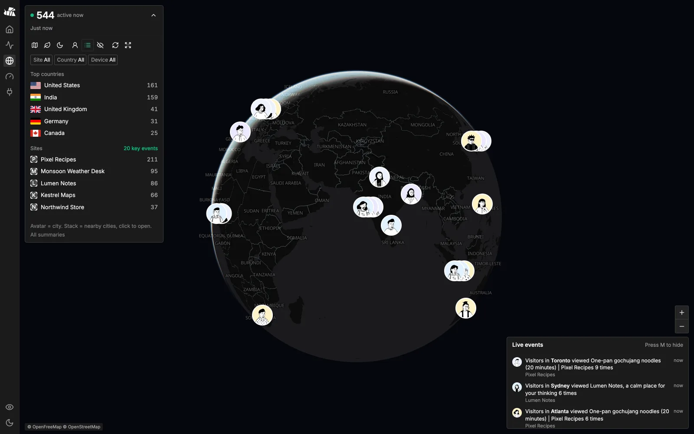

---

## Core features

Every report comes from your GA4 properties through the GA4 Data and Admin APIs, using a read-only service account. Keep your existing GA4 tag: there is no new tracking script and no event storage of its own. Search Console and AdSense are optional extras on top.

What that saves you:

- **No analytics server to pay for.** Self-hosted Rybbit or Plausible run ClickHouse and PostgreSQL, which grow to hundreds of GB, then TBs, over the years. GA4 stores and queries events for free, with no event cap on standard properties. MetriBee is one small stateless process that runs on your laptop, a Raspberry Pi or the cheapest VPS you already have.
- **Nothing to maintain.** No database to tune, back up, upgrade or resize, and no disk that fills up as traffic grows. Ten years of history costs the same as ten days: nothing.
- **Depth without the weight.** Lighter tools like Umami are easy to host but have fewer features, and their PostgreSQL row store slows down as years of events pile up. MetriBee gives you funnels, journeys, retention and a live globe on Google's warehouse.
- **No migration.** Years of GA4 history show up on day one. If you stop using MetriBee, your data is still in GA4.

What you get:

- **Intuitive UI on your GA4 reports.** Overview, Pages, Events, Journeys, Retention and Funnels in one shell, with click-to-filter, period comparison and keyboard shortcuts.
- **Every GA4 property on one screen.** Cards, Status, Table and Heatmap views across all properties the service account can see, with CSV export and optional AdSense earnings.
- **Realtime with spike alerts.** Live users from the GA4 Realtime API for every property, plus a live 3D globe.
- **Funnels, journeys, retention.** Built on GA4's native funnel reports, page paths and first-visit cohorts.
- **Search Console built in.** Clicks, impressions, CTR and position sit next to GA4 metrics in the same tables.
- **Widgets and share links.** Embeddable cards and badges from GA4 metrics, plus revocable private dashboards.
- **MCP server at `/mcp`.** Claude Code, Codex, Cursor and others can query your GA4 and Search Console data.
- **Quota-safe.** Report caches and per-property quota guards keep you inside GA4's free API limits.
- **Privacy mode.** Press **P** to blur names and URLs before screen sharing.

---

## Get started

Docker is the easiest way to run MetriBee. Paste this prompt into Claude Code, Codex, Gemini CLI or any AI agent that can run commands. The agent installs MetriBee, creates the Google service account and connects your GA4 properties.

```text
Install MetriBee (https://github.com/nexmoe/MetriBee) with Docker and connect it to my Google Analytics 4.

1. Check that Docker is installed and running. Clone the repo and cd into it.
2. Read SETUP.md and follow its "With an AI agent" prompt to create a Google Cloud service account
   and fill GA4_CLIENT_EMAIL and GA4_PRIVATE_KEY in .env. Use its Docker notes for the checks.
3. Run: docker compose pull && docker compose up -d
   Then run docker compose exec dashboard node scripts/setup-check.js until it passes.
4. Give me the URL from the ports line in docker-compose.yml.
5. Ask me if I also want the MCP server added to my AI tool. If yes, follow "Use with AI (MCP)" in SETUP.md.

Rules: never print the private key, never commit .env, and stop to ask me before any step that needs my
Google sign-in or GA4 admin access. The app has no login, so keep it on localhost unless I ask otherwise.
If Docker is not available, ask me before falling back to Node.js 22+ and pnpm (see "Install" in SETUP.md).
```

Want to set it up by hand, run it from source, or put it online behind Cloudflare Access or Tailscale? See [SETUP.md](SETUP.md). Every feature is documented in [docs/features.md](docs/features.md).

The workspace checks [GitHub Releases](https://github.com/nexmoe/MetriBee/releases) once per browser tab session. A newer version shows a dismissible notice linking to that release for a manual upgrade. Unavailable checks are skipped silently.

---

## Screenshots

All screenshots use demo mode (`DEMO=1`): generated data for 8 fictional sites, no Google account.

<table>
<tr>
<td width="50%">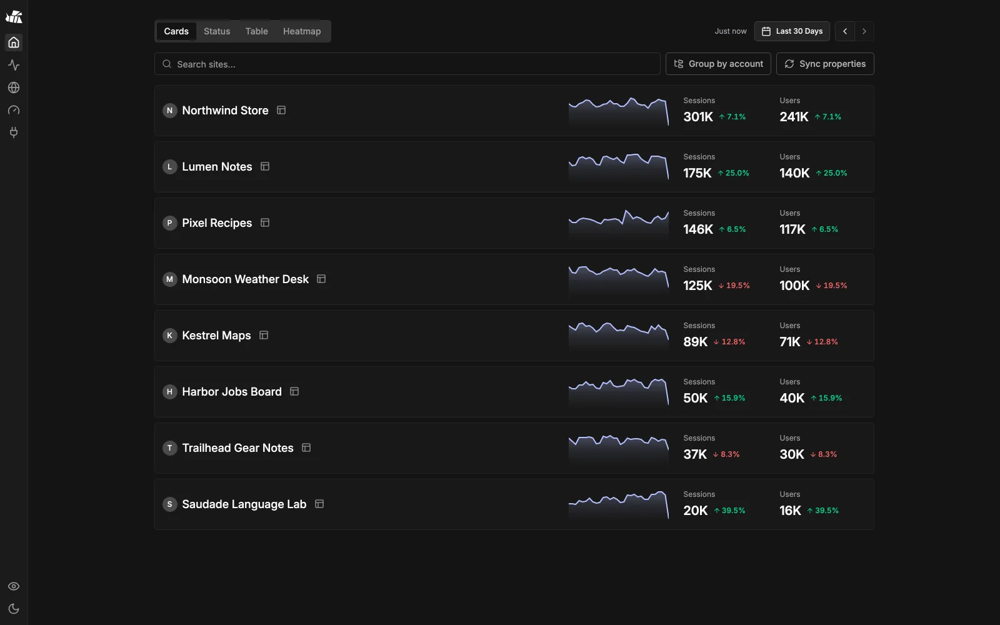</td>
<td width="50%">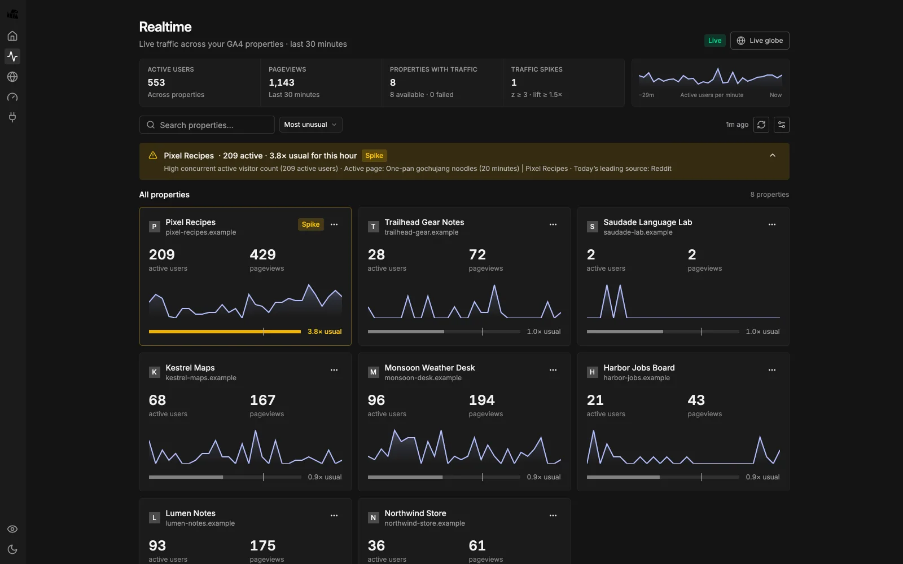</td>
</tr>
<tr><td><b>Home</b>: every property at a glance</td><td><b>Realtime</b>: live users and spike alerts across all sites</td></tr>
<tr>
<td>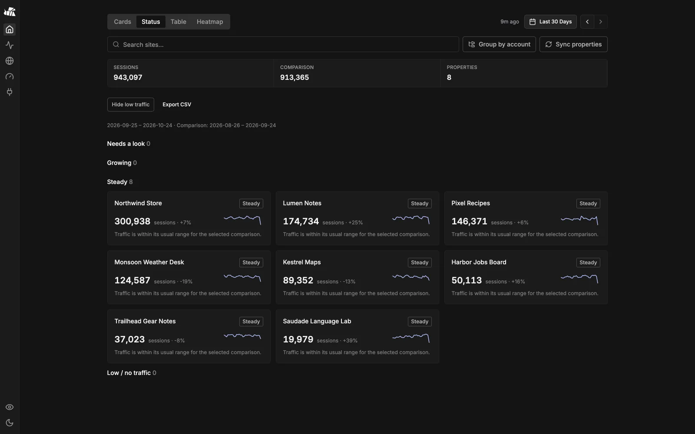</td>
<td>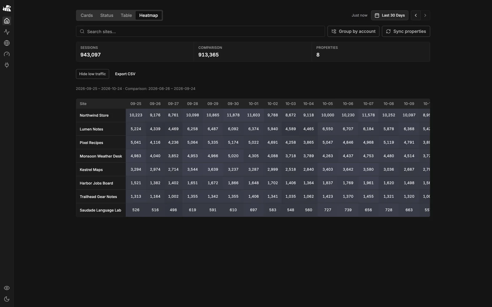</td>
</tr>
<tr><td><b>Status</b>: what needs a look today</td><td><b>Heatmap</b>: sessions per site per day</td></tr>
<tr>
<td>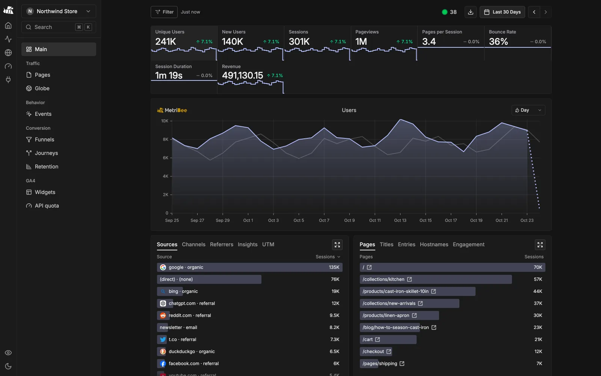</td>
<td>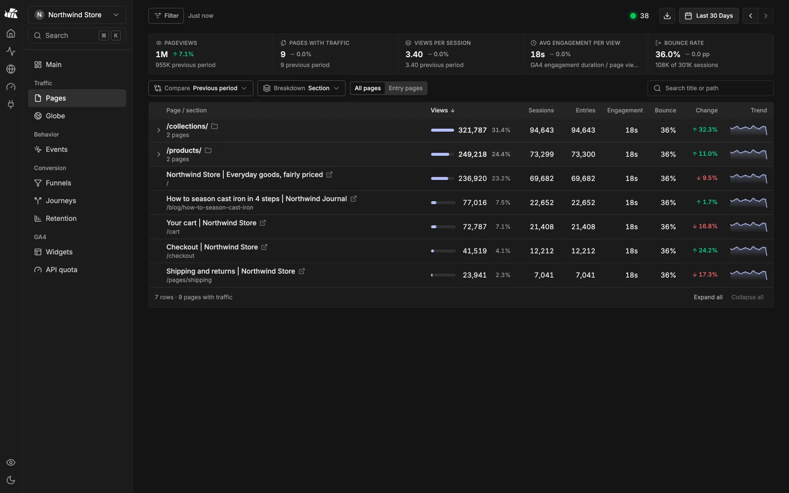</td>
</tr>
<tr><td><b>Overview</b>: GA4 reports in Rybbit's native cards</td><td><b>Pages</b>: GA4 and Search Console in one table</td></tr>
<tr>
<td>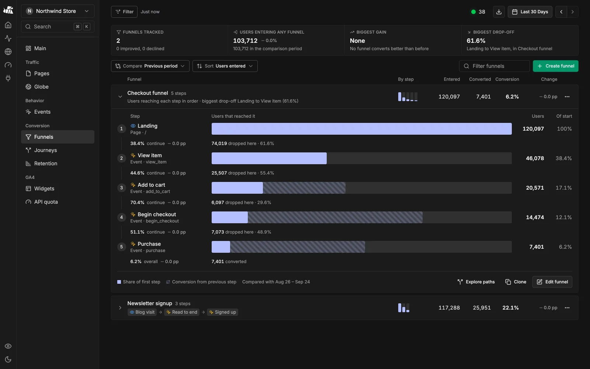</td>
<td>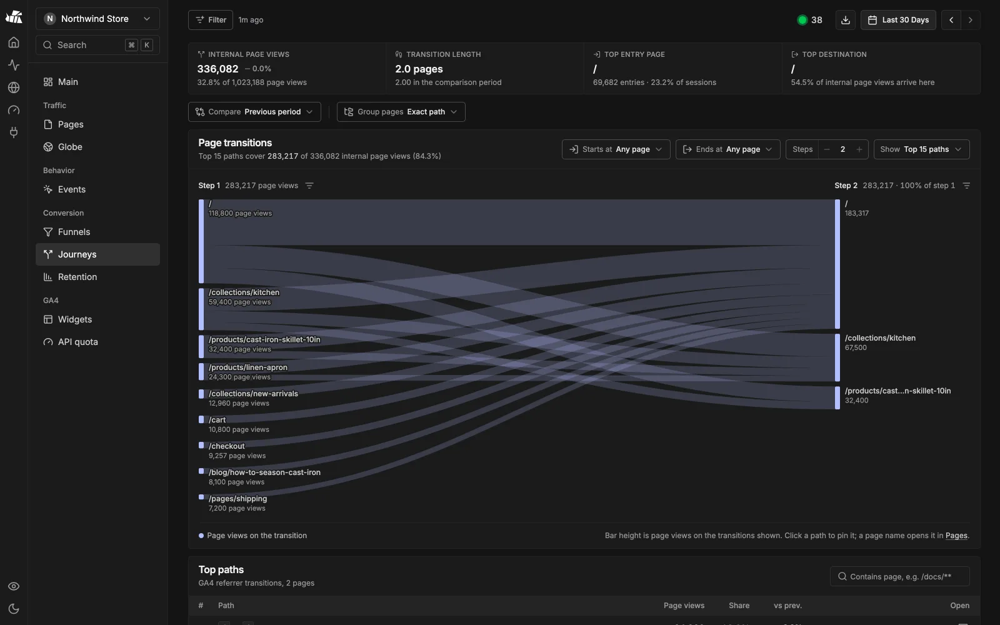</td>
</tr>
<tr><td><b>Funnels</b>: saved, ordered GA4 funnels</td><td><b>Journeys</b>: where visitors go next</td></tr>
<tr>
<td>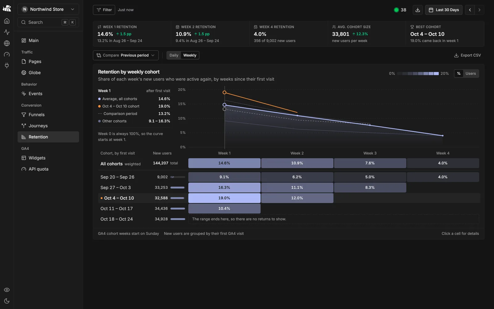</td>
<td>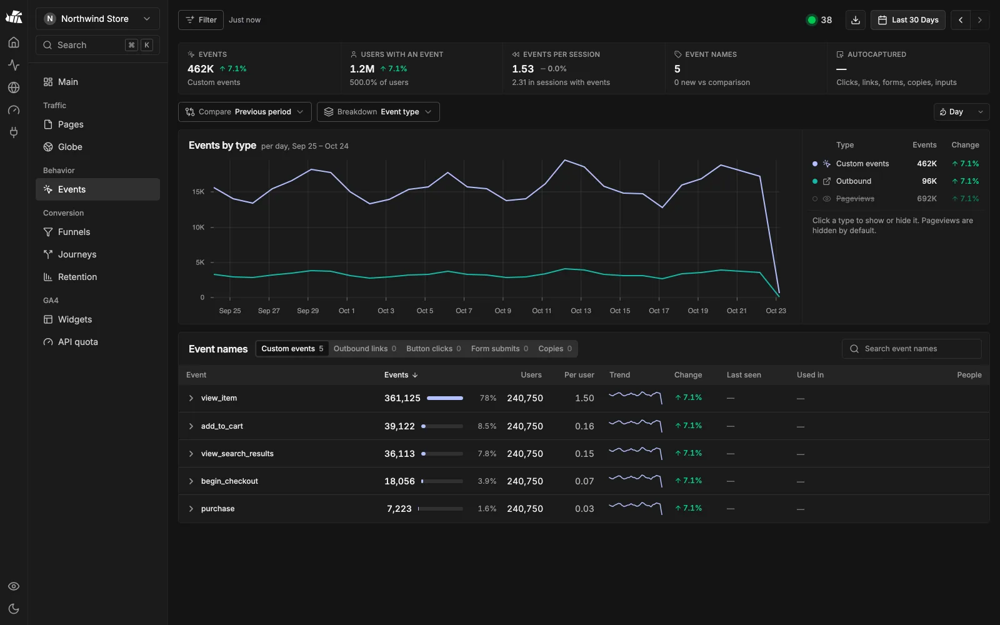</td>
</tr>
<tr><td><b>Retention</b>: GA4 first-visit cohorts</td><td><b>Events</b>: every GA4 event and key event</td></tr>
<tr>
<td>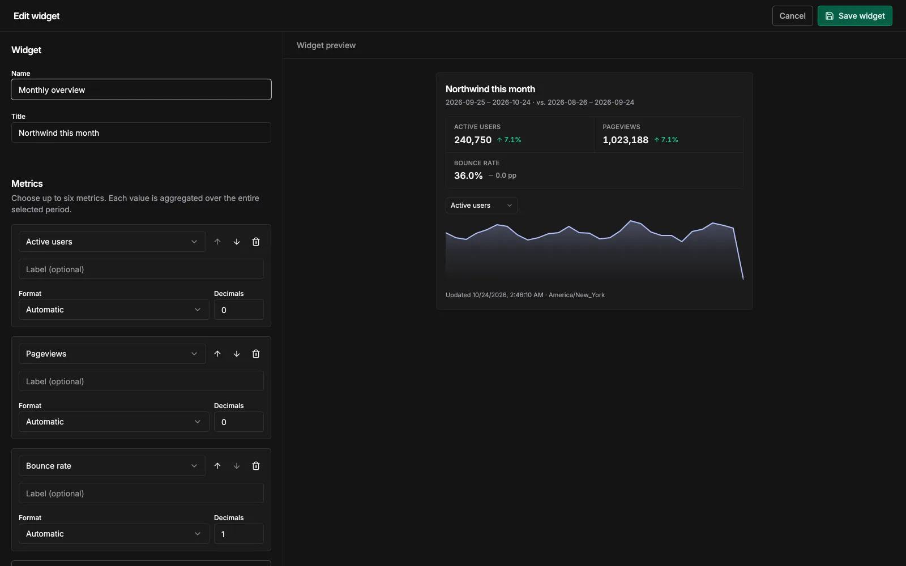</td>
<td>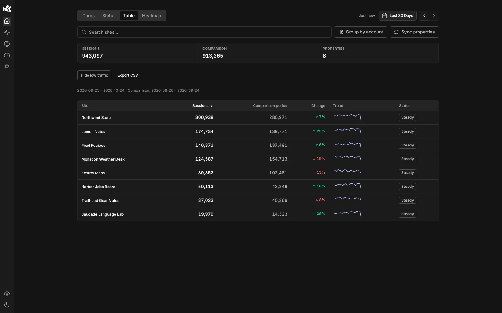</td>
</tr>
<tr><td><b>Widgets</b>: embeddable cards and badges</td><td><b>Table</b>: sortable, exportable per-site metrics</td></tr>
</table>

## How it compares

| | **MetriBee** | Rybbit (self-hosted) | Umami (self-hosted) | Plausible CE |
|---|:---:|:---:|:---:|:---:|
| **Hosting and cost** | | | | |
| Event storage on your server | ✅ none, Google stores it | ❌ ClickHouse, grows forever | ❌ PostgreSQL, grows forever | ❌ ClickHouse, grows forever |
| Services to run | 1 Node process | ClickHouse + Postgres + Redis + app | Postgres + app | ClickHouse + Postgres + app |
| Typical server | Smallest VPS / Pi | 2–4 GB RAM, 2 vCPU, 20–50 GB+ disk | 1–2 GB RAM | 2+ GB RAM |
| Free with unlimited events | ✅ | ✅ (you pay for the server) | ✅ (you pay for the server) | ✅ (you pay for the server) |
| Columnar engine for years of data | ✅ GA4 / BigQuery-class backend | ✅ ClickHouse | ⚠️ only if you add ClickHouse | ✅ ClickHouse |
| Keep existing GA4 tag, no migration | ✅ | ❌ new script | ❌ new script | ❌ new script |
| **Dashboards** | | | | |
| Multi-site home (cards, status, table, heatmap) | ✅ | ⚠️ site cards | ⚠️ site list | ⚠️ site list |
| Realtime overview across all sites | ✅ | ⚠️ per site | ⚠️ per site | ⚠️ per site |
| Traffic spike detection and alerts | ✅ | ❌ | ❌ | ❌ |
| Live 3D globe | ✅ | ✅ | ❌ | ❌ |
| Funnels | ✅ | ✅ | ✅ | ✅ |
| User journeys (Sankey) | ✅ | ✅ | ✅ | ✅ |
| Retention cohorts | ✅ | ✅ | ✅ | ❌ |
| Search Console in the same tables | ✅ | ✅ | ❌ | ✅ |
| Embeddable widgets and badges | ✅ | ❌ | ❌ | ⚠️ full dashboard iframe |
| Public or private share links | ✅ | ✅ | ✅ | ✅ |
| AdSense earnings per site | ✅ | ❌ | ❌ | ❌ |
| API quota monitor | ✅ | – | – | – |
| MCP server for AI assistants | ✅ built in | ✅ | ✅ | ❌ |
| Privacy mode for screen sharing | ✅ | ❌ | ❌ | ❌ |
| **Where the others win** | | | | |
| Session replay | ❌ | ✅ | ✅ | ❌ |
| Web Vitals and error tracking | ❌ | ✅ | ⚠️ Web Vitals | ❌ |
| You own every raw event | ❌ | ✅ | ✅ | ✅ |
| Cookieless, no consent banner | ❌ GA4 rules apply | ✅ | ✅ | ✅ |

✅ yes · ⚠️ partial or with caveats · ❌ no · – not applicable. Based on each project's public docs as of October 2026. Server sizes are typical guidance, not hard limits. If something here is out of date, please open an issue.

---

## Testing & building

```bash
pnpm test   # run the unit test suite (mocha)
pnpm build  # TypeScript compilation check
```

---

## Contributing

Open an issue first and wait for the `approved` label, then send one pull request per feature or fix. Full rules: [CONTRIBUTING.md](CONTRIBUTING.md).

---

## License

MetriBee is licensed under [AGPL-3.0](LICENSE). It includes MIT-licensed code from GA4-Dashboard-MCP ([license](LICENSES/MIT-GA4-Dashboard-MCP.txt)) and AGPL-3.0 code from Rybbit ([notices](frontend/third-party/NOTICE.md)). See [NOTICE](NOTICE) for details.

---

## Acknowledgements

- **[Rybbit](https://github.com/rybbit-io/rybbit)** by the Rybbit team. MetriBee's whole UI is Rybbit's React frontend, adapted to GA4 under AGPL-3.0. I really like Rybbit and ran it as my own analytics for a long time before building this. If you want tracking that is entirely your own (first-party script, every raw event on your servers, cookieless, session replay, web vitals and error tracking), use Rybbit. It's excellent, and you can [self-host it](https://rybbit.com/docs/self-hosting) or use [Rybbit Cloud](https://rybbit.com). MetriBee is for people who already have GA4 and want Rybbit's experience without running the storage.
- **[GA4-Dashboard-MCP](https://github.com/TheTechBasket/GA4-Dashboard-MCP)** by Amit Yadav ([@TheTechBasket](https://github.com/TheTechBasket)). MetriBee started as a fork of it. Its GA4 backend, quota handling, caching and MCP server are the foundation everything here is built on, and it remains MIT-licensed.

## Author

[@nexmoe](https://github.com/nexmoe) · [github.com/nexmoe/MetriBee](https://github.com/nexmoe/MetriBee)
